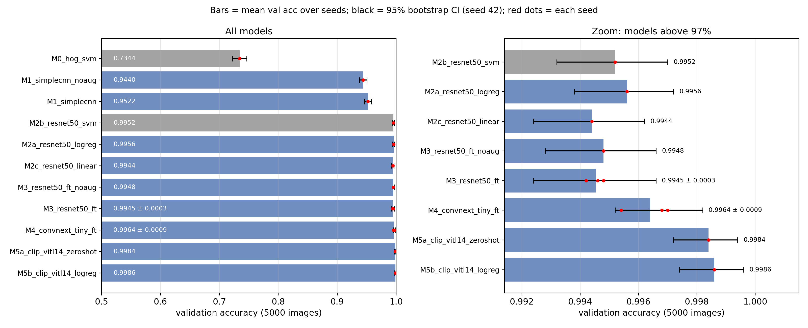
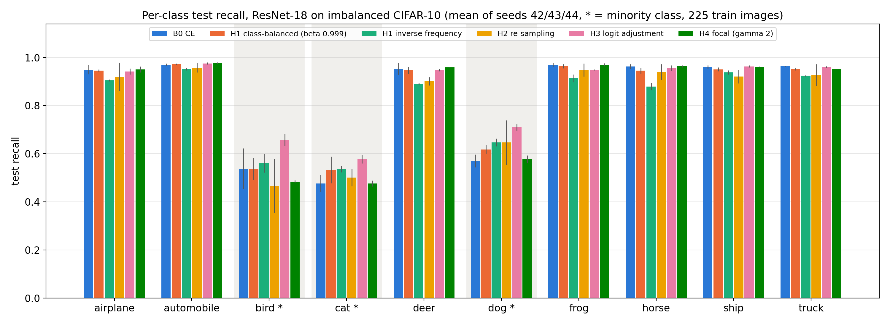

# IE4483 Mini Project (Option 2): Dogs vs. Cats

Code and results for the IE4483 Artificial Intelligence and Data Mining mini project (Option 2).
The main task is binary image classification (dog = 1, cat = 0) on a subset of the Kaggle Dogs vs. Cats
data: 10000 training images per class, 2500 validation images per class and 500 unlabeled test images.
We compare a hand-crafted baseline, a small CNN trained from scratch, fine-tuned ImageNet backbones and
CLIP. The same code is then applied to CIFAR-10 (part g) and to a CIFAR-10 version where three classes
have only 5% of their labels (part h).

## Team members

| name | matriculation no. |
|---|---|
| TODO | TODO |
| TODO | TODO |
| TODO | TODO |

## Contributions

- TODO: member 1
- TODO: member 2
- TODO: member 3

## Main results

**Dogs vs. Cats** (5000 validation images; the test labels are not available).

| model | val acc |
|---|---|
| HOG + LinearSVC | 0.7344 |
| SimpleCNN from scratch (no augmentation) | 0.9440 |
| SimpleCNN from scratch | 0.9522 |
| ResNet-50 frozen features + logistic regression | 0.9956 |
| ResNet-50 fine-tuned (seeds 42/43/44) | 0.99453 ± 0.00031 |
| ConvNeXt-Tiny fine-tuned (seeds 42/43/44) | 0.99640 ± 0.00087 |
| CLIP ViT-L/14 zero-shot | 0.9984 |
| CLIP ViT-L/14 frozen features + logistic regression | 0.9986 |
| **Final: CLIP zero-shot + ConvNeXt-Tiny (s42), flip TTA** | **0.9990** |

The final combination was picked on val, so its val accuracy is slightly optimistic. It is not
significantly better than CLIP + logistic regression (McNemar p = 0.69). Its test predictions are in
`submission.csv`.

**CIFAR-10, part g** (official 10000-image test set, evaluated once; seeds 42/43/44).

| model | val acc | test acc |
|---|---|---|
| ResNet-18 (CIFAR stem) from scratch, crop + flip + RandomErasing, 40 epochs | 0.94560 ± 0.00250 | 0.9428 ± 0.0021 |
| ConvNeXt-Tiny ImageNet-pretrained, 32 -> 224, 8 epochs | 0.98367 ± 0.00031 | 0.9819 ± 0.0015 |

**Imbalanced CIFAR-10, part h.** Bird, cat and dog keep 225 train images each (5%, ratio 20:1). Val and
test are balanced, so test accuracy equals balanced accuracy. ResNet-18 with the G1 recipe, seeds 42/43/44.

| method | test balanced acc | macro-F1 | minority recall | majority recall |
|---|---|---|---|---|
| cross-entropy (B0) | 0.8313 ± 0.0018 | 0.8195 ± 0.0013 | 0.5281 ± 0.0186 | 0.9613 ± 0.0100 |
| class-balanced loss, beta 0.999 | 0.8364 ± 0.0035 | 0.8274 ± 0.0057 | 0.5625 ± 0.0274 | 0.9538 ± 0.0070 |
| inverse-frequency weights | 0.8146 ± 0.0034 | 0.8082 ± 0.0046 | 0.5814 ± 0.0177 | 0.9145 ± 0.0030 |
| class-balanced re-sampling | 0.8128 ± 0.0047 | 0.8022 ± 0.0086 | 0.5380 ± 0.0638 | 0.9306 ± 0.0276 |
| **logit-adjusted loss, tau 1** | **0.8638 ± 0.0015** | **0.8590 ± 0.0018** | **0.6482 ± 0.0071** | 0.9561 ± 0.0032 |
| focal loss, gamma 2 | 0.8269 ± 0.0016 | 0.8144 ± 0.0017 | 0.5122 ± 0.0068 | 0.9617 ± 0.0026 |

Pretrained ConvNeXt-Tiny (seed 42): balanced acc 0.9514 with cross-entropy and 0.9668 with the
logit-adjusted loss (minority recall 0.8633 -> 0.9227). The method was chosen on val before the test run.

Detailed notes for the report: `results/dogcat/summary.md`, `results/cifar/summary_g.md`,
`results/cifar/summary_h.md`, `results/data_audit/audit.md`.






## Repository layout

```
src/                 shared code
  utils.py           paths, seeding, timer, csv helpers
  data.py            dogs vs cats dataset, transforms, seeded DataLoader
  models.py          SimpleCNN, ResNet-50, ConvNeXt-Tiny, CIFAR ResNet-18, input resize wrapper
  engine.py          training loop (AMP, warmup + cosine), prediction with optional flip TTA
  cifar.py           CIFAR-10 loading, 45k/5k split, imbalanced subset, transforms
  losses.py          class-balanced, inverse-frequency, logit-adjusted and focal losses
scripts/
  config.sh          python interpreter used by the run_*.sh scripts (only machine-specific path)
  audit_data.py      counts, broken files, sizes, near-duplicates
  cache_images.py    resized image cache
  make_data_figures.py
  train_dogcat.py    one dogs vs cats training run
  extract_features.py, probe_features.py   frozen ResNet-50 / CLIP features, zero-shot, linear probes
  hog_svm.py         HOG + LinearSVC baseline
  analyze_dogcat.py  tables, McNemar tests, final selection on val, submission.csv, figures
  plot_arch.py       architecture figures and shape tables
  gradcam.py         Grad-CAM figures
  prepare_cifar.py, train_cifar.py, cifar_selection.py, eval_cifar.py   part g
  eval_imbalance.py  part h
  run_dogcat.sh, run_cifar.sh, run_imbalance.sh   experiment queues
results/
  data_audit/        audit report, duplicate pairs, excluded train list
  dogcat/            summary.md, CSV tables, arch_*.txt, figures/, runs/<run>/
  cifar/             summary_g.md, summary_h.md, dataset_info.md, CSV tables, figures/, imbalance/, runs/<run>/
submission.csv       test predictions (id, label)
sampleSubmission.csv
```

Not in git: `data/` (images, cache, features), `checkpoints/`, `logs/`.

## Setup

Tested with Python 3.10, PyTorch 2.5.1 and torchvision 0.20.1 (CUDA 12.1) on Linux.

```bash
conda create -n ie4483 python=3.10 -y
conda activate ie4483
# install PyTorch for your CUDA version, see pytorch.org. We used:
pip install torch==2.5.1 torchvision==0.20.1 --index-url https://download.pytorch.org/whl/cu121
pip install -r requirements.txt
```

The `run_*.sh` scripts call the interpreter set in `scripts/config.sh`. Edit that line, or override it,
e.g. `PY=$(which python) bash scripts/run_dogcat.sh resnet`. Pretrained weights (torchvision ResNet-50 and
ConvNeXt-Tiny, open_clip ViT-L/14 `openai`) are downloaded automatically on first use.

## Data

Dogs vs. Cats: download the project dataset from NTULearn (a subset of the Kaggle Dogs vs. Cats
competition) and place it as

```
data/dataset/train/cat/*.jpg   data/dataset/train/dog/*.jpg
data/dataset/val/cat/*.jpg     data/dataset/val/dog/*.jpg
data/dataset/test/1.jpg ... 500.jpg
```

Keep `sampleSubmission.csv` in the repo root.

CIFAR-10 is downloaded by `scripts/prepare_cifar.py` into `data/cifar10/`. If the download from the
Toronto server is too slow, put `cifar-10-python.tar.gz` (md5 `c58f30108f718f92721af3b95e74349a`) into
`data/cifar10/` by hand and run the script again.

## Reproducing the results

Run everything from the repo root. Set a free GPU with `CUDA_VISIBLE_DEVICES`. Queues on different GPUs
can run in parallel. Each run writes `results/.../runs/<run_name>/` with `history.csv`, `val_preds.csv`
and `run_info.json`; checkpoints go to `checkpoints/`.

### 1. Data audit and cache (parts a, f)

```bash
python scripts/audit_data.py         # -> results/data_audit/ (audit.md, duplicate pairs, excluded_train.txt)
python scripts/cache_images.py       # short side 256, JPEG q95 -> data/cache256/
python scripts/make_data_figures.py  # sample and augmentation figures
```

The 19 train images in `results/data_audit/excluded_train.txt` (near-duplicates of val/test images) are
left out of training, so 19981 train images are used.

### 2. Dogs vs. Cats experiments (parts b-f)

```bash
CUDA_VISIBLE_DEVICES=1 bash scripts/run_dogcat.sh resnet     # ResNet-50 lr sweep, fine-tune x3 seeds, no-aug run
CUDA_VISIBLE_DEVICES=2 bash scripts/run_dogcat.sh convnext   # SimpleCNN (+ no-aug), ConvNeXt-Tiny lr sweep, x3 seeds
CUDA_VISIBLE_DEVICES=3 bash scripts/run_dogcat.sh features   # frozen ResNet-50 / CLIP features, zero-shot, linear probes
python scripts/hog_svm.py --workers 8                        # HOG + LinearSVC baseline (CPU)
```

A single run looks like
`python scripts/train_dogcat.py --model convnext_tiny --run-name my_run --lr 3e-5 --epochs 10 --seed 42`.

### 3. Analysis, figures and submission (parts b, d, e, f)

```bash
python scripts/analyze_dogcat.py   # comparison.csv, McNemar, TTA/ensemble selection on val, submission.csv, figures
python scripts/plot_arch.py simplecnn final resnet50 convnext_tiny clip_vitl14   # fig_arch_*.png, arch_*.txt
python scripts/gradcam.py --images test/374.jpg test/464.jpg test/47.jpg test/242.jpg --out fig_gradcam_test.png \
    --title "Grad-CAM on selected test images (class = predicted label, seed 42 checkpoints)"
python scripts/gradcam.py --images val/dog/dog.12092.jpg val/cat/cat.7920.jpg val/dog/dog.8507.jpg \
    --out fig_gradcam_val_errors.png --title "Grad-CAM on misclassified validation images (class = predicted label)"
```

`analyze_dogcat.py` writes `results/dogcat/submission.csv`; the copy in the repo root is the file we submit.

### 4. CIFAR-10 (part g)

```bash
python scripts/prepare_cifar.py                            # download, 45k/5k split (seed 42), dataset_info.md
CUDA_VISIBLE_DEVICES=1 bash scripts/run_cifar.sh g1        # ResNet-18: lr sweep, erasing / no-aug, seeds 43, 44 of the best
CUDA_VISIBLE_DEVICES=2 bash scripts/run_cifar.sh g2sweep   # ConvNeXt-Tiny lr sweep, 3 epochs on 15k images
CUDA_VISIBLE_DEVICES=2 bash scripts/run_cifar.sh g2 42     # ConvNeXt-Tiny full run, repeat with 43 and 44
for s in 43 44; do python scripts/train_cifar.py --model resnet18_cifar --run-name G1_resnet18_lr0.2_s$s --lr 0.2 --seed $s; done
python scripts/cifar_selection.py                          # val-only selection tables, G1 variant figure
python scripts/eval_cifar.py --groups G1_resnet18_lr0.2_erase G2_convnext_tiny --split val    # check on val first
python scripts/eval_cifar.py --groups G1_resnet18_lr0.2_erase G2_convnext_tiny                # official test set, once
```

The extra no-erasing seeds (fifth line) are only used to check the RandomErasing choice on val.

### 5. Imbalanced CIFAR-10 (part h)

```bash
for s in 42 43 44; do CUDA_VISIBLE_DEVICES=1 bash scripts/run_imbalance.sh g1 $s; done   # 6 methods x 3 seeds
CUDA_VISIBLE_DEVICES=2 bash scripts/run_imbalance.sh g2 ce      # ConvNeXt-Tiny with cross-entropy
CUDA_VISIBLE_DEVICES=3 bash scripts/run_imbalance.sh g2 best    # ConvNeXt-Tiny with the best method on val (waits for g1)
python scripts/eval_imbalance.py --split val                    # selection tables and figures on val
python scripts/eval_imbalance.py --split test                   # official test set, once
```

## Hardware and run time

One server with 4x NVIDIA RTX 3090 (24 GB), Intel Xeon W-2295 (36 threads), 251 GB RAM. The GPUs were
shared with other jobs, so times can vary. Approximate wall-clock times per run:

| experiment | time |
|---|---|
| data audit / image cache | 11 s / 8 s |
| SimpleCNN, 20 epochs | 4.7 min |
| ResNet-50 fine-tune, 10 epochs | 7.5 min |
| ConvNeXt-Tiny fine-tune, 10 epochs | 10.5 min |
| CLIP ViT-L/14 feature extraction (all splits) | 3.5 min |
| HOG + LinearSVC (CPU) | 2.3 min |
| CIFAR ResNet-18, 40 epochs | 5.3 min |
| CIFAR ConvNeXt-Tiny at 224, 8 epochs | 19.7 min |
| imbalanced CIFAR ResNet-18 / ConvNeXt-Tiny | 3.7 min / 13 min |

With three GPUs in parallel the dogs vs. cats queues take about 55 min, part g about 1.5 h and part h
about 40 min.

## Reproducibility

- Default seed 42. `set_seed` seeds `random`, NumPy and PyTorch (CPU and CUDA), and every DataLoader gets a
  seeded generator and `worker_init_fn`. cuDNN autotuning and AMP are on, so reruns can differ in the
  last digits.
- The main models are trained with seeds 42, 43 and 44 and reported as mean ± sample std: ResNet-50 and
  ConvNeXt-Tiny (dogs vs. cats), both CIFAR-10 models, and every ResNet-18 method in part h. The other
  runs (baselines, lr sweeps, ablations, part h ConvNeXt) use seed 42 only.
- Optimisation uses the train split only. Learning rates, augmentation choices, the final dogs vs. cats
  combination and the part h method are selected on val. The CIFAR-10 test set is used once at the end.
- The CIFAR-10 val split and the imbalanced subset are fixed with seed 42 (`results/cifar/val_indices.txt`).

## References

1. Kaggle. Dogs vs. Cats. https://www.kaggle.com/c/dogs-vs-cats, 2013.
2. K. He, X. Zhang, S. Ren and J. Sun. Deep residual learning for image recognition. CVPR, 2016.
3. Z. Liu, H. Mao, C.-Y. Wu, C. Feichtenhofer, T. Darrell and S. Xie. A ConvNet for the 2020s. CVPR, 2022.
4. A. Radford, J. W. Kim, C. Hallacy et al. Learning transferable visual models from natural language
   supervision. ICML, 2021.
5. A. Krizhevsky. Learning multiple layers of features from tiny images. Technical report, University of
   Toronto, 2009.
6. Y. Cui, M. Jia, T.-Y. Lin, Y. Song and S. Belongie. Class-balanced loss based on effective number of
   samples. CVPR, 2019.
7. A. K. Menon, S. Jayasumana, A. S. Rawat, H. Jain, A. Veit and S. Kumar. Long-tail learning via logit
   adjustment. ICLR, 2021.
8. T.-Y. Lin, P. Goyal, R. Girshick, K. He and P. Dollár. Focal loss for dense object detection. ICCV, 2017.
9. R. R. Selvaraju, M. Cogswell, A. Das, R. Vedantam, D. Parikh and D. Batra. Grad-CAM: Visual
   explanations from deep networks via gradient-based localization. ICCV, 2017.
