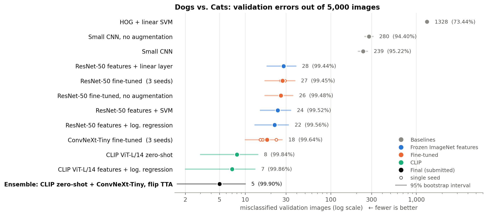
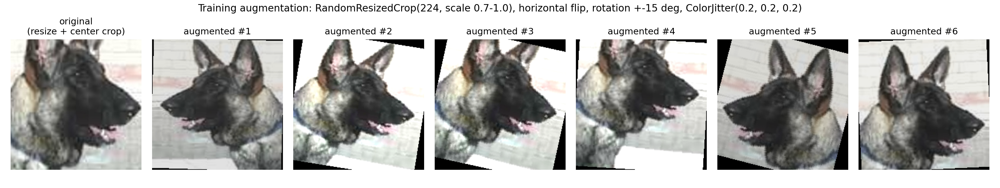
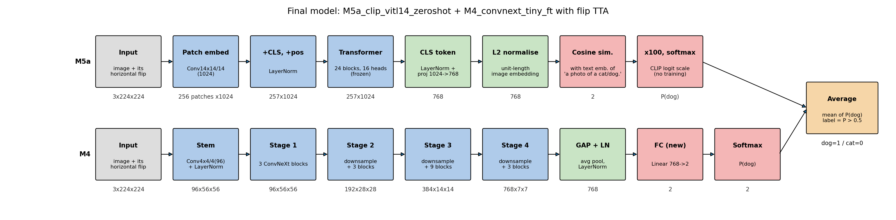
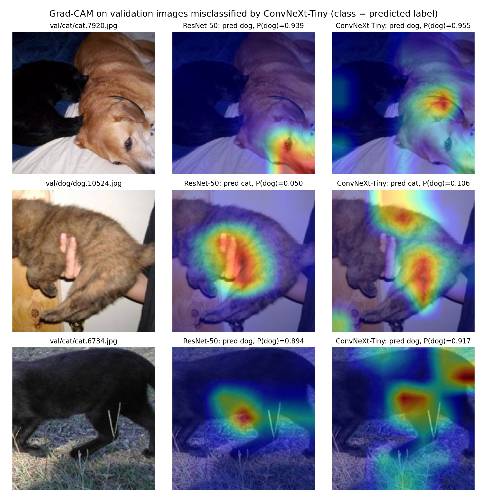
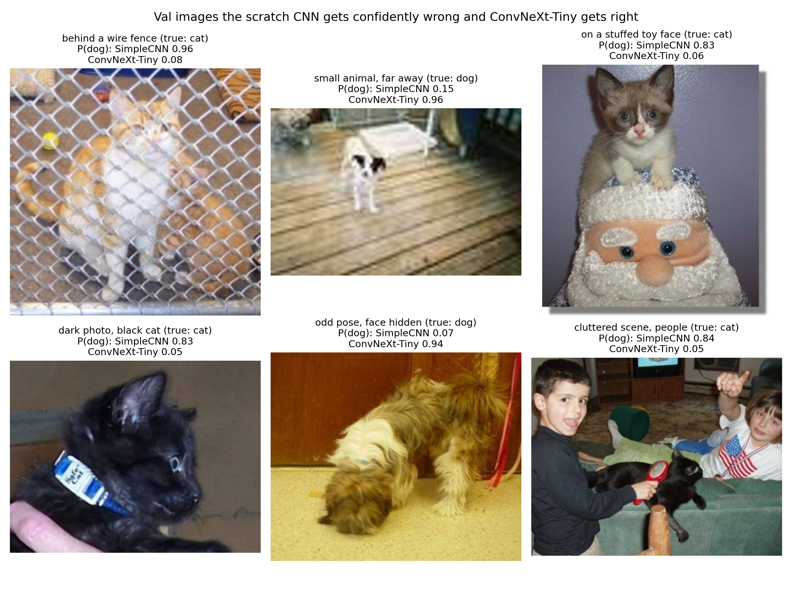
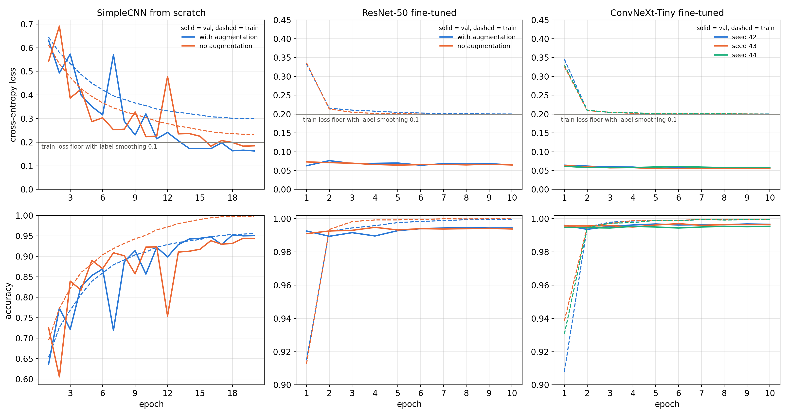
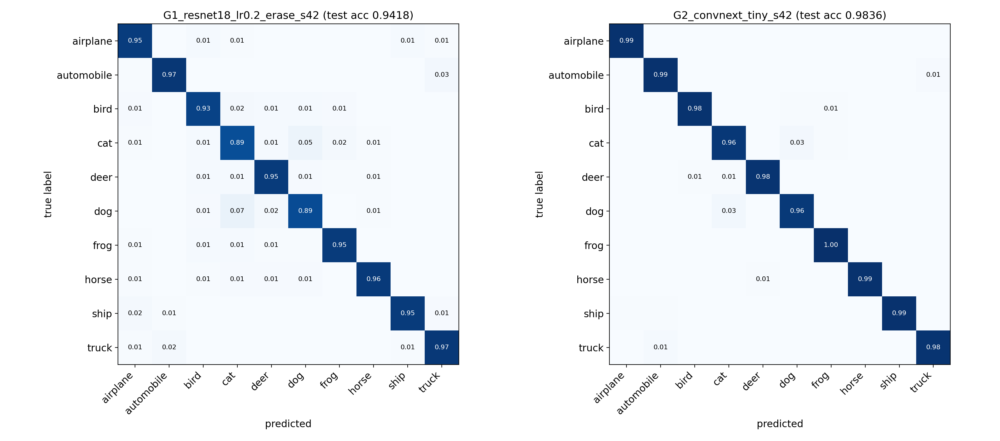
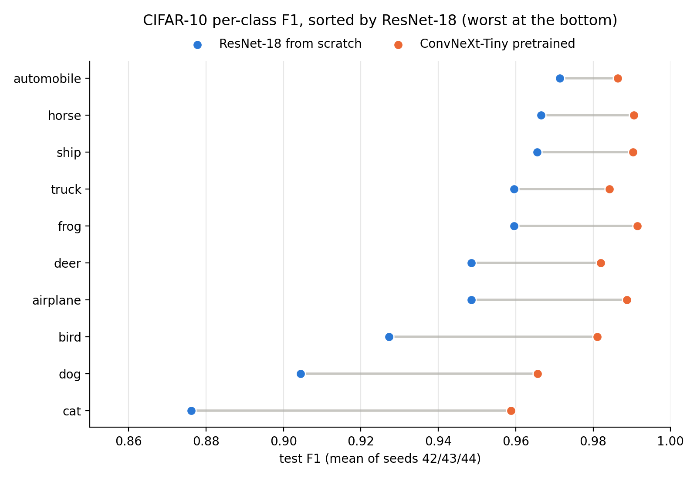
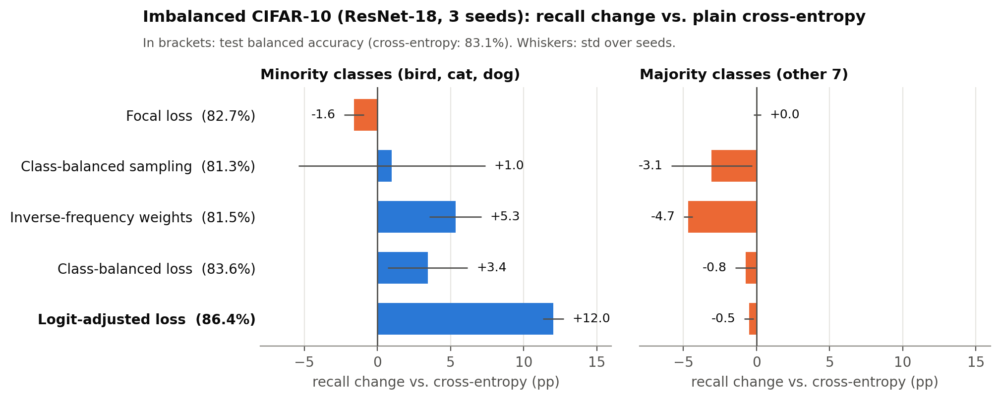
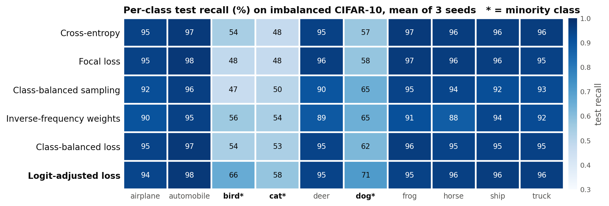

# Dogs vs. Cats and CIFAR-10 Image Classification

We started with a simple question, dog or cat, and kept asking how far each step really gets you:
hand-made features, a small CNN, pretrained ResNet-50 and ConvNeXt, and finally CLIP. The same code
then goes on to CIFAR-10 and to a CIFAR-10 version where three classes have almost no labels.

Mini project for IE4483 Artificial Intelligence and Data Mining at NTU (AY2026/27), written in PyTorch.


[](https://colab.research.google.com/github/sinh0612/ie4483-dogs-vs-cats/blob/main/notebooks/demo_clip_zeroshot.ipynb)

The Colab badge opens the CLIP zero-shot demo notebook. It only works while the repo is public.

<p align="center">
  
</p>

## Quick facts

- The task is binary image classification. Label convention: **1 = dog, 0 = cat**.
- Data: 10,000 cats and 10,000 dogs for training, 2,500 of each for validation, 500 unlabeled test images.
- Best result: **99.90%** validation accuracy (5 mistakes out of 5,000). The test predictions are in `submission.csv`.
- CIFAR-10: **98.19%** test accuracy with a pretrained ConvNeXt-Tiny, 94.28% for a ResNet-18 trained from scratch.
- Imbalanced CIFAR-10: a logit-adjusted loss lifts recall on the rare classes by **12 points** and costs the
  common classes only 0.5.
- Settings are chosen on the validation set only, and main models are run with 3 seeds.

## Repository layout

```
.
├── README.md                      # this file
├── submission.csv                 # test predictions (1 = dog, 0 = cat)
├── sampleSubmission.csv           # submission format from the course
├── requirements.txt               # pip packages (torch is installed separately)
├── notebooks/
│   └── demo_clip_zeroshot.ipynb   # try the classifier on Colab, no weights needed
├── src/                           # library code
│   ├── utils.py                   # paths, seeding, timer, csv helpers
│   ├── data.py                    # dataset, transforms, loaders
│   ├── models.py                  # SimpleCNN, ResNet-50, ConvNeXt-Tiny, CIFAR ResNet-18
│   ├── engine.py                  # training loop (AMP, warm-up + cosine), prediction with flip TTA
│   ├── cifar.py                   # CIFAR-10 loading, 45k/5k split, imbalanced subset
│   └── losses.py                  # class-balanced, inverse-frequency, logit-adjusted and focal losses
├── scripts/                       # the commands you run
│   ├── audit_data.py              # finds broken and duplicate images
│   ├── cache_images.py            # resizes every image to short side 256
│   ├── make_data_figures.py       # sample and augmentation figures
│   ├── train_dogcat.py            # one Dogs vs. Cats training run
│   ├── hog_svm.py                 # HOG + linear SVM baseline
│   ├── extract_features.py        # frozen ResNet-50 / CLIP features, CLIP zero-shot
│   ├── probe_features.py          # logistic regression, SVM and linear layer on frozen features
│   ├── analyze_dogcat.py          # tables, McNemar tests, final model pick, submission.csv, figures
│   ├── plot_arch.py               # architecture figures and layer shape tables
│   ├── gradcam.py                 # Grad-CAM figures
│   ├── hard_cases.py              # images the scratch CNN gets wrong and the final model gets right
│   ├── prepare_cifar.py           # downloads CIFAR-10, makes the 45k/5k split
│   ├── train_cifar.py             # one CIFAR-10 run (also the imbalanced runs)
│   ├── cifar_selection.py         # CIFAR-10 validation tables for choosing settings
│   ├── eval_cifar.py              # CIFAR-10 test evaluation, run once
│   ├── cifar_per_class.py         # per-class F1 plot for CIFAR-10
│   ├── eval_imbalance.py          # imbalanced CIFAR-10 tables and figures
│   ├── make_readme_figures.py     # summary figures in docs/figures
│   ├── config.sh                  # Python path used by the run_*.sh scripts
│   └── run_dogcat.sh, run_cifar.sh, run_imbalance.sh   # experiment queues
├── results/                       # tables, figures, per-run histories
└── docs/figures/                  # figures used in this README
```

The dataset, model weights and logs are not in the repo because they are too large.

## Contents

- [Repository layout](#repository-layout)
- [The data](#the-data)
- [The models](#the-models)
- [How we picked the settings](#how-we-picked-the-settings)
- [Results on Dogs vs. Cats](#results-on-dogs-vs-cats)
- [Where the model goes wrong](#where-the-model-goes-wrong)
- [What actually moves the accuracy](#what-actually-moves-the-accuracy)
- [CIFAR-10](#cifar-10)
- [CIFAR-10 with three rare classes](#cifar-10-with-three-rare-classes)
- [Limitations](#limitations)
- [Running the code](#running-the-code)
- [References](#references)

## The data

Before training anything we checked the images. None are broken, sizes vary a lot (median about
448 × 374, smallest 37 × 32), and perceptual hashing found **20 near-duplicate pairs** across the splits
(12 train-val, 8 train-test). We dropped the 19 train-side copies so the validation score is not
inflated by images the model has already seen. That leaves 19,981 training images, and we use all of
them plus all 5,000 validation images. Three of those pairs are the same "photo unavailable"
placeholder with different labels, which is noise that comes with the original Kaggle data.

Every image is resized once so its shorter side is 256 px, which makes training much faster. During
training each image gets a random crop to 224 × 224, a horizontal flip, a rotation of up to 15° and
some color jitter. Validation and test images are only resized and center-cropped. All inputs are
normalized with the ImageNet mean and std, because that is what the pretrained backbones expect.

<p align="center">
  
</p>

## The models

We built the comparison as a ladder, so each step changes one thing:

| step | model | what is trained |
|---|---|---|
| hand-made features | HOG + linear SVM | the SVM only |
| learn from scratch | small CNN, 5 conv blocks (1.6 M params) | everything |
| reuse ImageNet features | ResNet-50 frozen + logistic regression / SVM / linear layer | the classifier only |
| fine-tune | ResNet-50 and ConvNeXt-Tiny | all layers |
| bigger pretraining | CLIP ViT-L/14, zero-shot and with logistic regression | nothing / the classifier only |

The final model averages two of them: CLIP zero-shot and the fine-tuned ConvNeXt-Tiny, each looking at
the image and its mirror. ConvNeXt-Tiny is the trained part. It takes a 3 × 224 × 224 image, goes
through four stages down to a 768 × 7 × 7 feature map, pools it to a 768-d vector and maps that to
2 outputs. It is trained with cross-entropy (label smoothing 0.1), AdamW, one epoch of warm-up and
then a cosine schedule, mixed precision, and we keep the epoch with the best validation accuracy.

<p align="center">
  
</p>

## How we picked the settings

Learning rate was the setting that mattered most, so we swept it on the validation set:

| learning rate | 1e-5 | 3e-5 | 1e-4 | 3e-4 | 1e-3 |
|---|---:|---:|---:|---:|---:|
| ResNet-50 val acc | 99.12% | 99.40% | **99.42%** | 99.08% | 98.44% |
| ConvNeXt-Tiny val acc | 99.54% | **99.62%** | 99.62% | 99.38% | |

Too high a rate (1e-3) wipes out part of what the backbone learned on ImageNet, and too low a rate
learns too slowly. For ConvNeXt the two best rates tie, so we took 3e-5 because its validation loss
was lower. Fine-tuning runs for 10 epochs, which is plenty: validation accuracy levels off after about
5 (see the curves further down). The
training loss flattens at about 0.2. That is not a bug: with label smoothing 0.1 and two classes the
loss cannot go lower than 0.199.

## Results on Dogs vs. Cats

| model | val accuracy | mistakes / 5,000 |
|---|---:|---:|
| HOG + linear SVM | 73.44% | 1,328 |
| Small CNN from scratch | 95.22% | 239 |
| ResNet-50 frozen + logistic regression | 99.56% | 22 |
| ResNet-50 fine-tuned (3 seeds) | 99.45 ± 0.03% | 27 |
| ConvNeXt-Tiny fine-tuned (3 seeds) | 99.64 ± 0.09% | 18 |
| CLIP ViT-L/14 zero-shot, no training | 99.84% | 8 |
| CLIP ViT-L/14 + logistic regression | 99.86% | 7 |
| **Final: CLIP zero-shot + ConvNeXt-Tiny, with flip** | **99.90%** | **5** |

The final model was picked on validation, so its number is slightly optimistic. It beats the best
single model by only 2 images, and a McNemar test says that gap could be chance (p = 0.69). On the
500 test images it gives exactly the same labels as ConvNeXt-Tiny and both CLIP models, so
`submission.csv` (259 dogs, 241 cats) does not depend on which of them we pick.

## Where the model goes wrong

Only 5 of the 500 test images make the strong models disagree or come close to 50/50. The clearest
failure is the "no photo available" placeholder: there is no animal in it, but the model has to answer
cat or dog anyway. Curled-up kittens and animals behind cage bars are the other hard cases.

On the validation set, 4 of the 5 mistakes have **both a cat and a dog** in the picture, or show just a
paw. Grad-CAM shows the model looking at the most visible animal, which is often not the one in the
label. In the middle row the label is cat, but the dog fills most of the frame, so "dog" is a
reasonable answer:

<p align="center">
  
</p>

So the model is very strong on clear photos of a single animal. Its weak spots are images with two
animals, a tiny or hidden animal, or no animal at all, and a two-class model has no way to say
"neither" or "both".

The pretrained models also fix many images that a CNN trained from scratch gets confidently wrong: a cat
behind a wire fence, a small dog far away, a kitten sitting on a stuffed toy, a black cat in a dark photo.
The small CNN leans on color and background, while the pretrained features find the animal itself.

<p align="center">
  
</p>

## What actually moves the accuracy

- **Pretraining is the big one.** Swapping the small CNN for a linear layer on frozen ResNet-50 features
  cuts mistakes from 239 to 28 (McNemar p < 1e-50).
- **Full fine-tuning did not beat the frozen features** for ResNet-50, at about 10 times the compute. A
  better backbone did help: ConvNeXt-Tiny beats ResNet-50 (p = 0.043), and CLIP, pretrained on far more
  data, does best of all.
- **Augmentation helps when training from scratch.** The small CNN gains 0.8 points and its train-val gap
  drops from 5.4 to 0.1 points. Once the backbone is pretrained, augmentation makes no measurable
  difference.

<p align="center">
  
</p>

## CIFAR-10

CIFAR-10 has 60,000 color images of 32 × 32 pixels in 10 balanced classes. We split 5,000 images off
the 50,000 training images for validation, and used the 10,000 official test images only once at the
end. Compared with Dogs vs. Cats, the output layer has 10 classes instead of 2 and the augmentation is
a random crop with 4-pixel padding plus a flip, which suits tiny images better than a large random
crop. The ResNet-18 trained from scratch also gets CIFAR's own normalization, SGD instead of AdamW, and
a 3 × 3 first layer without max-pooling, because the usual stem would shrink a 32 × 32 image to 8 × 8
before the first residual block. The pretrained ConvNeXt-Tiny keeps the ImageNet normalization and sees
the images upscaled to 224 × 224.

| model | val accuracy | test accuracy | train time |
|---|---:|---:|---:|
| ResNet-18 from scratch, 40 epochs, SGD lr 0.2 | 94.56 ± 0.25% | 94.28 ± 0.21% | 5.3 min |
| ConvNeXt-Tiny pretrained, images upscaled to 224, 8 epochs | 98.37 ± 0.03% | **98.19 ± 0.15%** | 19.7 min |

Augmentation matters a lot here: without it the ResNet-18 memorizes the training set (100% train
accuracy) and reaches only 88.9% on validation. Random erasing added another 0.4 points.

Cat and dog are the most confused pair for both models, 21% and 34% of all mistakes. At 32 × 32 most
of the face and fur detail that makes Dogs vs. Cats easy is gone, and upscaling cannot bring it back.
Car versus truck comes second, mostly pickups and SUVs that sit between the two classes.

<p align="center">
  
</p>

Per class, cat, dog and bird are the weakest for the ResNet-18 (F1 0.876, 0.904, 0.927, mean of 3 seeds),
and that is also where pretraining helps most.

<p align="center">
  
</p>

## CIFAR-10 with three rare classes

We kept only 225 training images (5%) of bird, cat and dog and left the other seven classes at 4,500,
an imbalance of 20 to 1. Validation and test stay balanced, so test accuracy is the same as balanced
accuracy. Every method uses the same ResNet-18 recipe and 3 seeds.

| method | balanced acc | macro-F1 | rare-class recall | common-class recall |
|---|---:|---:|---:|---:|
| plain cross-entropy | 83.13 ± 0.18% | 81.95% | 52.8% | 96.1% |
| focal loss (γ = 2) | 82.69 ± 0.16% | 81.44% | 51.2% | 96.2% |
| class-balanced sampling | 81.28 ± 0.47% | 80.22% | 53.8% | 93.1% |
| inverse-frequency weights | 81.46 ± 0.34% | 80.82% | 58.1% | 91.5% |
| class-balanced loss (β = 0.999) | 83.64 ± 0.35% | 82.74% | 56.2% | 95.4% |
| **logit-adjusted loss (τ = 1)** | **86.38 ± 0.15%** | **85.90%** | **64.8%** | 95.6% |

<p align="center">
  
</p>

- Without any fix, rare-class images get pulled into look-alike common classes: birds become deer
  or frogs, cats become frogs or deer.
- **Logit adjustment** works best. It shifts the decision toward the rare classes by an amount set by
  how rare they are, so the rare classes gain 12 points while the common ones lose only 0.5, and the
  result barely changes between seeds.
- Inverse-frequency weights and re-sampling push too hard. The model memorizes the 225 rare images and
  the common classes drop 3 to 5 points, so the overall score ends up below doing nothing.
- Focal loss does not help, because it does not look at class frequency at all.
- Pretraining is the strongest fix of all. A pretrained ConvNeXt-Tiny with plain cross-entropy already
  gets 86.3% rare-class recall, and 92.3% with logit adjustment.

<p align="center">
  
</p>

## Limitations

- The Dogs vs. Cats test labels are not public, so all Dogs vs. Cats numbers are validation numbers.
- CLIP was pretrained on 400 million web images. The Kaggle photos also come from the web, so some
  overlap is possible and the zero-shot score may be a bit optimistic.
- The final ensemble and the imbalance method were chosen on validation from a handful of options, so
  the last few tenths of a percent may partly be selection luck.
- The ConvNeXt-Tiny imbalance runs use one seed and label smoothing, so we compare them with each other,
  not with the ResNet-18 rows.

## Running the code

<details>
<summary><b>Setup and data</b></summary>

Tested with Python 3.10, PyTorch 2.5.1 and torchvision 0.20.1 (CUDA 12.1) on Linux.

```bash
conda create -n ie4483 python=3.10 -y
conda activate ie4483
pip install torch==2.5.1 torchvision==0.20.1 --index-url https://download.pytorch.org/whl/cu121
pip install -r requirements.txt
```

The `run_*.sh` scripts use the Python set in `scripts/config.sh`, or you can override it with
`PY=$(which python) bash scripts/run_dogcat.sh resnet`. Pretrained weights download on first use.

Put the course dataset here and keep `sampleSubmission.csv` in the repo root:

```
data/dataset/train/{cat,dog}/*.jpg
data/dataset/val/{cat,dog}/*.jpg
data/dataset/test/1.jpg ... 500.jpg
```

CIFAR-10 is downloaded by `scripts/prepare_cifar.py` into `data/cifar10/`. If the download is slow,
put `cifar-10-python.tar.gz` (md5 `c58f30108f718f92721af3b95e74349a`) there by hand and run it again.
</details>

<details>
<summary><b>Reproducing every result</b></summary>

Run from the repo root and pick free GPUs with `CUDA_VISIBLE_DEVICES`. The queues can run in parallel.

```bash
# data check and image cache
python scripts/audit_data.py
python scripts/cache_images.py
python scripts/make_data_figures.py

# Dogs vs. Cats
CUDA_VISIBLE_DEVICES=1 bash scripts/run_dogcat.sh resnet     # ResNet-50 lr sweep, 3 seeds, no-aug run
CUDA_VISIBLE_DEVICES=2 bash scripts/run_dogcat.sh convnext   # SimpleCNN, ConvNeXt-Tiny lr sweep, 3 seeds
CUDA_VISIBLE_DEVICES=3 bash scripts/run_dogcat.sh features   # frozen ResNet-50 / CLIP features, zero-shot, probes
python scripts/hog_svm.py --workers 8
python scripts/analyze_dogcat.py                             # tables, McNemar, final pick, submission.csv
python scripts/plot_arch.py simplecnn final resnet50 convnext_tiny clip_vitl14
python scripts/gradcam.py --images test/374.jpg test/464.jpg test/47.jpg test/242.jpg --out fig_gradcam_test.png \
    --title "Grad-CAM on selected test images (class = predicted label, seed 42 checkpoints)"
python scripts/gradcam.py --images val/dog/dog.12092.jpg val/cat/cat.7920.jpg val/dog/dog.8507.jpg \
    --out fig_gradcam_val_errors.png --title "Grad-CAM on misclassified validation images (class = predicted label)"
python scripts/hard_cases.py

# CIFAR-10
python scripts/prepare_cifar.py
CUDA_VISIBLE_DEVICES=1 bash scripts/run_cifar.sh g1
CUDA_VISIBLE_DEVICES=2 bash scripts/run_cifar.sh g2sweep
for s in 42 43 44; do CUDA_VISIBLE_DEVICES=2 bash scripts/run_cifar.sh g2 $s; done
for s in 43 44; do python scripts/train_cifar.py --model resnet18_cifar --run-name G1_resnet18_lr0.2_s$s --lr 0.2 --seed $s; done
python scripts/cifar_selection.py
python scripts/eval_cifar.py --groups G1_resnet18_lr0.2_erase G2_convnext_tiny --split val
python scripts/eval_cifar.py --groups G1_resnet18_lr0.2_erase G2_convnext_tiny     # official test set, once
python scripts/cifar_per_class.py                          # per-class F1 from the saved test predictions

# CIFAR-10 with rare classes
for s in 42 43 44; do CUDA_VISIBLE_DEVICES=1 bash scripts/run_imbalance.sh g1 $s; done
CUDA_VISIBLE_DEVICES=2 bash scripts/run_imbalance.sh g2 ce
CUDA_VISIBLE_DEVICES=3 bash scripts/run_imbalance.sh g2 best
python scripts/eval_imbalance.py --split val
python scripts/eval_imbalance.py --split test

# README figures
python scripts/make_readme_figures.py
```

Each run writes `results/.../runs/<run_name>/` with `history.csv`, `val_preds.csv` and `run_info.json`.
Seeds are fixed for Python, NumPy, PyTorch and every DataLoader. cuDNN autotuning and mixed precision
are on, so a rerun can differ in the last digit.
</details>

<details>
<summary><b>Hardware and run time</b></summary>

One server with 4 × RTX 3090 (24 GB), shared with other jobs.

| experiment | time per run |
|---|---:|
| data check / image cache | 11 s / 8 s |
| small CNN, 20 epochs | 4.7 min |
| ResNet-50 fine-tune, 10 epochs | 7.5 min |
| ConvNeXt-Tiny fine-tune, 10 epochs | 10.5 min |
| CLIP ViT-L/14 features, all splits | 3.5 min |
| HOG + linear SVM (CPU) | 2.3 min |
| CIFAR-10 ResNet-18, 40 epochs | 5.3 min |
| CIFAR-10 ConvNeXt-Tiny at 224 px, 8 epochs | 19.7 min |
| imbalanced CIFAR-10, ResNet-18 / ConvNeXt-Tiny | 3.7 / 13 min |

With three GPUs in parallel everything runs in about 3 hours.
</details>

## References

1. Kaggle. Dogs vs. Cats. https://www.kaggle.com/c/dogs-vs-cats, 2013.
2. K. He, X. Zhang, S. Ren and J. Sun. Deep residual learning for image recognition. CVPR, 2016.
3. Z. Liu, H. Mao, C.-Y. Wu, C. Feichtenhofer, T. Darrell and S. Xie. A ConvNet for the 2020s. CVPR, 2022.
4. A. Radford, J. W. Kim, C. Hallacy et al. Learning transferable visual models from natural language supervision. ICML, 2021.
5. A. Krizhevsky. Learning multiple layers of features from tiny images. Tech. report, University of Toronto, 2009.
6. Y. Cui, M. Jia, T.-Y. Lin, Y. Song and S. Belongie. Class-balanced loss based on effective number of samples. CVPR, 2019.
7. A. K. Menon, S. Jayasumana, A. S. Rawat, H. Jain, A. Veit and S. Kumar. Long-tail learning via logit adjustment. ICLR, 2021.
8. T.-Y. Lin, P. Goyal, R. Girshick, K. He and P. Dollár. Focal loss for dense object detection. ICCV, 2017.
9. R. R. Selvaraju, M. Cogswell, A. Das, R. Vedantam, D. Parikh and D. Batra. Grad-CAM: Visual explanations from deep networks via gradient-based localization. ICCV, 2017.
