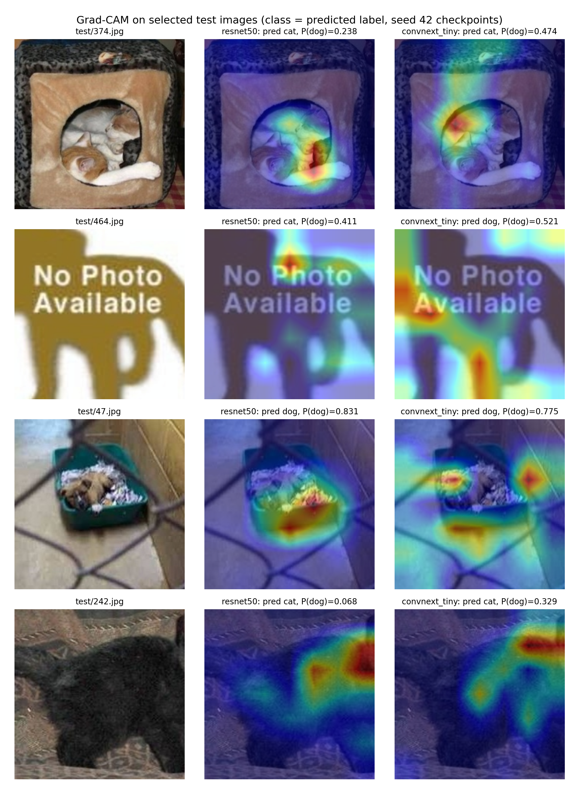

# Dogs vs. Cats, CIFAR-10 and Imbalanced CIFAR-10 in PyTorch

Image classification from hand-crafted features up to CLIP, on three problems: Dogs vs. Cats
(binary), CIFAR-10 (10 classes) and a CIFAR-10 version where three classes keep only 5% of their
labels. All choices are made on a validation split, every main result is repeated over 3 seeds, and
model differences are checked with bootstrap intervals and McNemar tests.

Group project for IE4483 Artificial Intelligence and Data Mining, Nanyang Technological University (AY2026/27).


<p align="center">
  
</p>

## Highlights

| | |
|---|---|
| **99.90%** | Dogs vs. Cats validation accuracy (5 errors out of 5,000), down from 1,328 errors for HOG + SVM |
| **98.19%** | CIFAR-10 test accuracy with a fine-tuned ConvNeXt-Tiny; 94.28% for a ResNet-18 trained from scratch in about 5 minutes |
| **+12.0 pp** | recall on the rare classes with a logit-adjusted loss, at a cost of only 0.5 pp on the common classes |
| **19** | near-duplicate train images found and removed before training, so validation is not leaked |

## Results

### Dogs vs. Cats

20,000 train / 5,000 validation / 500 unlabeled test images (subset of the Kaggle competition).

| approach | val accuracy | errors / 5,000 |
|---|---:|---:|
| HOG features + linear SVM | 73.44% | 1,328 |
| Small CNN from scratch (1.6 M params) | 95.22% | 239 |
| ResNet-50, frozen ImageNet features + logistic regression | 99.56% | 22 |
| ResNet-50, fine-tuned (3 seeds) | 99.45 ± 0.03% | 27 |
| ConvNeXt-Tiny, fine-tuned (3 seeds) | 99.64 ± 0.09% | 18 |
| CLIP ViT-L/14, zero-shot (no training at all) | 99.84% | 8 |
| CLIP ViT-L/14, frozen features + logistic regression | 99.86% | 7 |
| **Final: CLIP zero-shot + ConvNeXt-Tiny, flip TTA** | **99.90%** | **5** |

What the comparison shows:

- **Pretraining matters most.** Replacing the small CNN with a linear layer on frozen ResNet-50
  features cuts the errors from 239 to 28 (McNemar p < 1e-50).
- **Full fine-tuning did not beat a linear model on frozen ResNet-50 features**, even though it cost about 10 times
  more compute. A stronger backbone (ConvNeXt-Tiny, p = 0.043) or a better pretraining corpus (CLIP) helped more.
- **Augmentation helps when training from scratch** (+0.8 pp, train-val gap 5.4 pp to 0.1 pp) and
  makes no measurable difference once the backbone is pretrained.
- The final ensemble was picked on validation, so its score is slightly optimistic. It is
  only 2 images better than the best single model (p = 0.69). On the 500 test images it predicts
  exactly the same labels as ConvNeXt-Tiny and both CLIP models.

<p align="center">
  
  <br><sub>Grad-CAM on hard test images. Typical failure cases: placeholder images with no animal, curled-up kittens, cluttered cages.</sub>
</p>

### CIFAR-10

45,000 train / 5,000 validation (split from the official training set) / 10,000 official test images,
used once at the end.

| model | val accuracy | test accuracy | train time |
|---|---:|---:|---:|
| ResNet-18 (CIFAR stem), from scratch, 40 epochs | 94.56 ± 0.25% | 94.28 ± 0.21% | 5.3 min |
| ConvNeXt-Tiny, ImageNet-pretrained, 32 → 224 px, 8 epochs | 98.37 ± 0.03% | **98.19 ± 0.15%** | 19.7 min |

Cat ↔ dog is the most confused pair for both models (21% and 34% of all errors). At 32 × 32 the face
and fur details that make Dogs vs. Cats easy are mostly gone, and upsampling cannot bring them back.

<p align="center">
  
</p>

### Imbalanced CIFAR-10

Bird, cat and dog keep 225 training images each (5%, imbalance ratio 20 : 1). Validation and test stay
balanced, so test accuracy equals balanced accuracy. Same ResNet-18 recipe for every method, 3 seeds.

| method | balanced acc | macro-F1 | rare-class recall | common-class recall |
|---|---:|---:|---:|---:|
| cross-entropy | 83.13 ± 0.18% | 81.95% | 52.8% | 96.1% |
| focal loss (γ = 2) | 82.69 ± 0.16% | 81.44% | 51.2% | 96.2% |
| class-balanced re-sampling | 81.28 ± 0.47% | 80.22% | 53.8% | 93.1% |
| inverse-frequency weights | 81.46 ± 0.34% | 80.82% | 58.1% | 91.5% |
| class-balanced loss (β = 0.999) | 83.64 ± 0.35% | 82.74% | 56.2% | 95.4% |
| **logit-adjusted loss (τ = 1)** | **86.38 ± 0.15%** | **85.90%** | **64.8%** | 95.6% |

<p align="center">
  
</p>

- Logit adjustment is the only method that clearly helps the rare classes without hurting the
  common ones, and its results barely change across seeds.
- Inverse-frequency weights and re-sampling over-correct: the model memorises the 225 rare images and
  the common classes lose 3-5 pp.
- Pretraining is the bigger lever. A pretrained ConvNeXt-Tiny with plain cross-entropy already
  reaches 86.3% rare-class recall (95.1% balanced accuracy); adding logit adjustment gives 92.3%
  (96.7%).

<p align="center">
  
</p>

## How it works

- **Data audit.** Perceptual hashing (pHash, Hamming distance ≤ 5) finds 20 near-duplicate pairs
  across splits. The 19 train-side copies are left out of training. Three of the pairs are Kaggle
  "photo unavailable" placeholders with different labels.
- **Training recipe** (fine-tuning). AdamW, 1-epoch linear warm-up then cosine decay, label
  smoothing 0.1, mixed precision. Learning rates come from a validation sweep. The checkpoint kept
  is the epoch with the best validation accuracy.
- **Model selection.** Training uses the train split only. Hyperparameters, the final Dogs vs. Cats
  combination and the imbalance method are all chosen on validation. The CIFAR-10 test set is
  evaluated once.
- **Uncertainty.** Main models run with seeds 42, 43 and 44 (mean ± sample std). Single runs get 95%
  bootstrap intervals, and paired model comparisons use McNemar's exact test.

<details>
<summary><b>Repository layout</b></summary>

```
src/
  utils.py            paths, seeding, timer, csv helpers
  data.py             Dogs vs. Cats dataset, transforms, seeded DataLoader
  models.py           SimpleCNN, ResNet-50, ConvNeXt-Tiny, CIFAR ResNet-18
  engine.py           training loop (AMP, warm-up + cosine), prediction with flip TTA
  cifar.py            CIFAR-10 loading, 45k/5k split, imbalanced subset
  losses.py           class-balanced, inverse-frequency, logit-adjusted and focal losses
scripts/
  audit_data.py, cache_images.py, make_data_figures.py
  train_dogcat.py, extract_features.py, probe_features.py, hog_svm.py
  analyze_dogcat.py, plot_arch.py, gradcam.py
  prepare_cifar.py, train_cifar.py, cifar_selection.py, eval_cifar.py, eval_imbalance.py
  make_readme_figures.py
  run_dogcat.sh, run_cifar.sh, run_imbalance.sh, config.sh
results/
  data_audit/         duplicate pairs, excluded train list
  dogcat/             tables, McNemar tests, figures, per-run histories
  cifar/              part g and imbalance tables, figures, per-run histories
docs/figures/         figures used in this README
submission.csv        test predictions (id, label; 1 = dog, 0 = cat)
```

`data/`, `checkpoints/` and `logs/` are not tracked.
</details>

<details>
<summary><b>Setup and data</b></summary>

Tested with Python 3.10, PyTorch 2.5.1 and torchvision 0.20.1 (CUDA 12.1) on Linux.

```bash
conda create -n ie4483 python=3.10 -y
conda activate ie4483
pip install torch==2.5.1 torchvision==0.20.1 --index-url https://download.pytorch.org/whl/cu121
pip install -r requirements.txt
```

The `run_*.sh` scripts use the interpreter set in `scripts/config.sh`, or override it with
`PY=$(which python) bash scripts/run_dogcat.sh resnet`. Pretrained weights (torchvision ResNet-50,
ConvNeXt-Tiny, open_clip ViT-L/14 `openai`) download automatically.

Dogs vs. Cats: place the course dataset as

```
data/dataset/train/{cat,dog}/*.jpg
data/dataset/val/{cat,dog}/*.jpg
data/dataset/test/1.jpg ... 500.jpg
```

and keep `sampleSubmission.csv` in the repo root. CIFAR-10 is downloaded by `scripts/prepare_cifar.py`
into `data/cifar10/`. If the download is slow, put `cifar-10-python.tar.gz`
(md5 `c58f30108f718f92721af3b95e74349a`) there by hand and rerun the script.
</details>

<details>
<summary><b>Reproducing the results</b></summary>

Run from the repo root. Pick free GPUs with `CUDA_VISIBLE_DEVICES`; the queues can run in parallel.

```bash
# data audit and image cache
python scripts/audit_data.py
python scripts/cache_images.py
python scripts/make_data_figures.py

# Dogs vs. Cats
CUDA_VISIBLE_DEVICES=1 bash scripts/run_dogcat.sh resnet     # ResNet-50 lr sweep, 3 seeds, no-aug run
CUDA_VISIBLE_DEVICES=2 bash scripts/run_dogcat.sh convnext   # SimpleCNN, ConvNeXt-Tiny lr sweep, 3 seeds
CUDA_VISIBLE_DEVICES=3 bash scripts/run_dogcat.sh features   # frozen ResNet-50 / CLIP features, zero-shot, probes
python scripts/hog_svm.py --workers 8
python scripts/analyze_dogcat.py                             # tables, McNemar, final selection, submission.csv
python scripts/plot_arch.py simplecnn final resnet50 convnext_tiny clip_vitl14
python scripts/gradcam.py --images test/374.jpg test/464.jpg test/47.jpg test/242.jpg --out fig_gradcam_test.png \
    --title "Grad-CAM on selected test images (class = predicted label, seed 42 checkpoints)"
python scripts/gradcam.py --images val/dog/dog.12092.jpg val/cat/cat.7920.jpg val/dog/dog.8507.jpg \
    --out fig_gradcam_val_errors.png --title "Grad-CAM on misclassified validation images (class = predicted label)"

# CIFAR-10
python scripts/prepare_cifar.py
CUDA_VISIBLE_DEVICES=1 bash scripts/run_cifar.sh g1
CUDA_VISIBLE_DEVICES=2 bash scripts/run_cifar.sh g2sweep
for s in 42 43 44; do CUDA_VISIBLE_DEVICES=2 bash scripts/run_cifar.sh g2 $s; done
for s in 43 44; do python scripts/train_cifar.py --model resnet18_cifar --run-name G1_resnet18_lr0.2_s$s --lr 0.2 --seed $s; done
python scripts/cifar_selection.py
python scripts/eval_cifar.py --groups G1_resnet18_lr0.2_erase G2_convnext_tiny --split val
python scripts/eval_cifar.py --groups G1_resnet18_lr0.2_erase G2_convnext_tiny     # official test set, once

# Imbalanced CIFAR-10
for s in 42 43 44; do CUDA_VISIBLE_DEVICES=1 bash scripts/run_imbalance.sh g1 $s; done
CUDA_VISIBLE_DEVICES=2 bash scripts/run_imbalance.sh g2 ce
CUDA_VISIBLE_DEVICES=3 bash scripts/run_imbalance.sh g2 best
python scripts/eval_imbalance.py --split val
python scripts/eval_imbalance.py --split test

# README figures
python scripts/make_readme_figures.py
```

Each run writes `results/.../runs/<run_name>/` (`history.csv`, `val_preds.csv`, `run_info.json`);
checkpoints go to `checkpoints/`. Seeds are fixed for Python, NumPy, PyTorch and every DataLoader.
cuDNN autotuning and AMP are on, so reruns can differ in the last digit.
</details>

<details>
<summary><b>Hardware and run time</b></summary>

One server with 4 × RTX 3090 (24 GB), Xeon W-2295, 251 GB RAM, shared with other jobs.

| experiment | time per run |
|---|---:|
| data audit / image cache | 11 s / 8 s |
| SimpleCNN, 20 epochs | 4.7 min |
| ResNet-50 fine-tune, 10 epochs | 7.5 min |
| ConvNeXt-Tiny fine-tune, 10 epochs | 10.5 min |
| CLIP ViT-L/14 feature extraction, all splits | 3.5 min |
| HOG + linear SVM (CPU) | 2.3 min |
| CIFAR-10 ResNet-18, 40 epochs | 5.3 min |
| CIFAR-10 ConvNeXt-Tiny at 224 px, 8 epochs | 19.7 min |
| imbalanced CIFAR-10, ResNet-18 / ConvNeXt-Tiny | 3.7 / 13 min |

With three GPUs in parallel the whole project runs in about 3 hours.
</details>

## Limitations

- The Dogs vs. Cats test labels are not public, so all Dogs vs. Cats numbers are on validation.
- CLIP was pretrained on 400 M web image-text pairs. Kaggle's cat and dog photos come from the web, so
  some overlap with that corpus cannot be ruled out, and the CLIP zero-shot score may be optimistic.
- The ensemble, the TTA choice and the imbalance method were chosen on validation from a small set of candidates. Part of the
  last few tenths of a percent may be selection noise.
- The imbalanced runs with ConvNeXt-Tiny used one seed and label smoothing 0.1, so they are compared with each
  other, not with the ResNet-18 rows.

## Team

| name | matriculation no. | main contributions |
|---|---|---|
| Nguyen Ma Sinh | TODO | TODO |
| TODO | TODO | TODO |
| TODO | TODO | TODO |

## References

1. Kaggle. Dogs vs. Cats. https://www.kaggle.com/c/dogs-vs-cats, 2013.
2. K. He, X. Zhang, S. Ren and J. Sun. Deep residual learning for image recognition. CVPR, 2016.
3. Z. Liu, H. Mao, C.-Y. Wu, C. Feichtenhofer, T. Darrell and S. Xie. A ConvNet for the 2020s. CVPR, 2022.
4. A. Radford, J. W. Kim, C. Hallacy et al. Learning transferable visual models from natural language supervision. ICML, 2021.
5. A. Krizhevsky. Learning multiple layers of features from tiny images. Tech. report, University of Toronto, 2009.
6. Y. Cui, M. Jia, T.-Y. Lin, Y. Song and S. Belongie. Class-balanced loss based on effective number of samples. CVPR, 2019.
7. A. K. Menon, S. Jayasumana, A. S. Rawat, H. Jain, A. Veit and S. Kumar. Long-tail learning via logit adjustment. ICLR, 2021.
8. T.-Y. Lin, P. Goyal, R. Girshick, K. He and P. Dollár. Focal loss for dense object detection. ICCV, 2017.
9. R. R. Selvaraju, M. Cogswell, A. Das, R. Vedantam, D. Parikh and D. Batra. Grad-CAM: Visual explanations from deep networks via gradient-based localization. ICCV, 2017.
